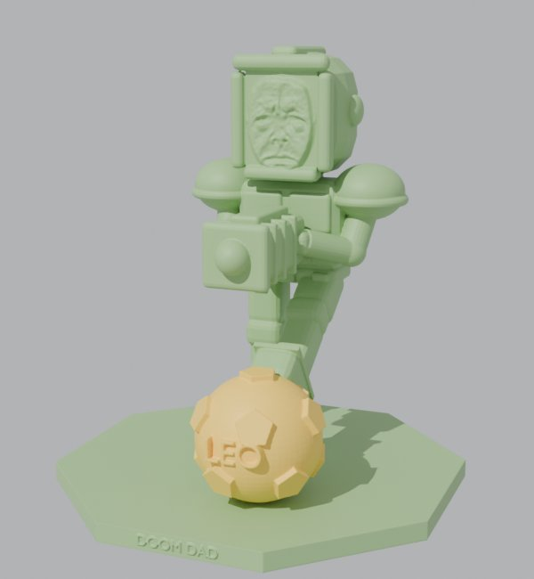
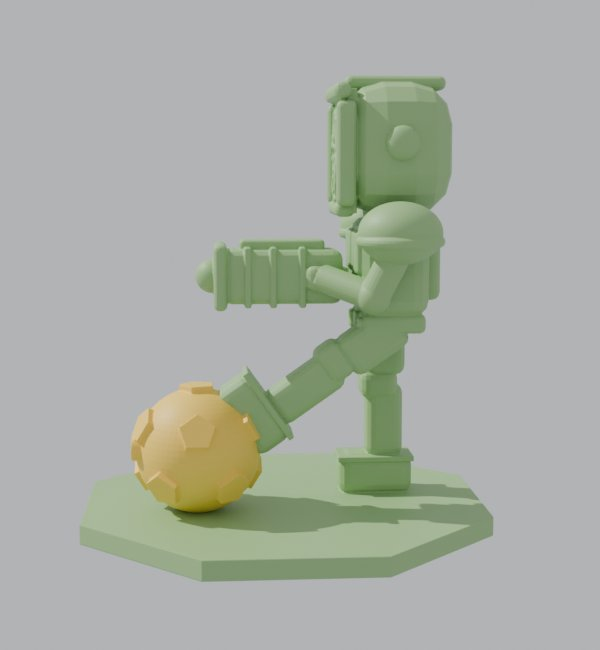

# Doom Dad kicking the LEO BOMB: 3D print

 

Doom Dad, the ultimate boss from Tower Defence, kicking the golden LEO BOMB soccer ball, on an octagon base with
DOOM DAD on the front. 134 × 134 × 150 mm. Both files are watertight and ready to slice.

| File | Use it for |
|------|-----------|
| `doom-dad-kick.stl` | One solid piece, any printer, one colour. |
| `doom-dad-kick.3mf` | Two parts already lined up: Doom Dad + base (green) and the ball (gold). For a multi-colour printer (Bambu AMS, Prusa MMU), give each part its colour. On a single-colour printer you can also print it in one go, or pause and swap filament. |

## Printing it

- **Supports: yes.** The BFG, the arms and the kicking leg overhang. Tree/organic supports come off cleanest.
- **Resin printer:** gives the best face; tilt it back about 20°, hollow it, and add drain holes in the base.
- **FDM:** 0.12–0.16 mm layers for the face, 15% infill, brim optional (the base is 134 mm wide, so it sits flat).
- **Bigger or smaller:** scale it in the slicer. At 100 mm tall the face gets soft on FDM; 150 mm or more is best.

The face is a relief made from a photo: bright skin stands out, the eyes, brows and mouth sink in. Light from one
side shows it best.

Made by `models/build_doomdad_print.py` (Blender): change that and re-run it rather than editing these files.
